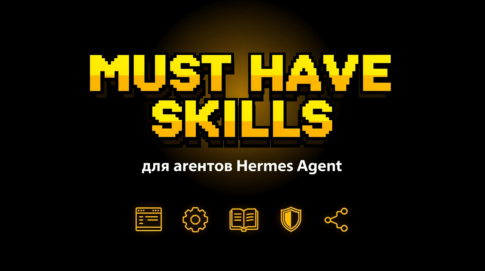

# hermes-agent-must-have-skills



**Маст-хэв скиллы для [Hermes Agent](https://github.com/NousResearch/hermes-agent).**

Готовый набор из 6 скиллов, которые стоят у нас на каждом агенте. Закрывают 80% типовых задач: пусть агент ищет и ставит скиллы сам, создаёт свои, не убивает git, ведёт базу знаний и правит документы.

## Набор

| Скилл | Что делает | Установка |
|-------|-----------|-----------|
| **[find-skills](https://skills.sh)** | сам находит и ставит скиллы через `npx skills`. Ставится первым | `npx skills add vercel-labs/find-skills -a hermes-agent -y` |
| **[skill-creator](https://skills.sh)** | сам создаёт и правит скиллы по канону SKILL.md | `npx skills add anthropics/skill-creator -a hermes-agent -y` |
| **[git-guardrails](hooks/block-dangerous-git.sh)** | хук, блокирующий `push --force`, `reset --hard`, `branch -D`, `clean -f` | копи в `~/.hermes/hooks/` + 3 строки в config.yaml |
| **[llm-wiki](skills/llm-wiki/SKILL.md)** | персистентная база знаний в маркдауне (паттерн Karpathy). Альтернатива RAG | в репо: `skills/llm-wiki/` |
| **[dox-setup](skills/dox-setup/SKILL.md)** | self-documenting проекты ([agent0ai/dox](https://github.com/agent0ai/dox)): иерархия AGENTS.md | в репо: `skills/dox-setup/` |
| **[officecli](skills/officecli/SKILL.md)** | работа с .docx/.xlsx/.pptx. Один бинарник, без Office | в репо: `skills/officecli/` + бинарник |

## Быстрый старт

```bash
# из экосистемы skills.sh
npx skills add vercel-labs/find-skills -a hermes-agent -y
npx skills add anthropics/skill-creator -a hermes-agent -y

# из этого репо
git clone https://github.com/defdis/hermes-agent-must-have-skills.git
cp -r hermes-agent-must-have-skills/skills/{llm-wiki,dox-setup,officecli} ~/.hermes/skills/

# git-guardrails
cp hermes-agent-must-have-skills/hooks/block-dangerous-git.sh ~/.hermes/hooks/
chmod +x ~/.hermes/hooks/block-dangerous-git.sh
```

Хук в `~/.hermes/config.yaml`:

```yaml
hooks:
  tool_use:
    - command: ~/.hermes/hooks/block-dangerous-git.sh
```

## Структура

```
├── README.md
├── banner.jpg
├── hooks/block-dangerous-git.sh
└── skills/
    ├── llm-wiki/
    ├── dox-setup/
    └── officecli/
```

## Лицензия

Скиллы экосистемы — лицензии авторов (MIT/Apache). Остальное — MIT.